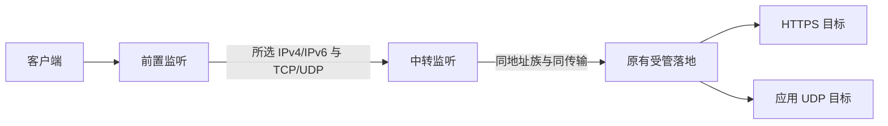

# 第二十一轮：双地址族 TCP 与限定 UDP 跨实例编排

本轮在既有三台实例模型上扩展 IPv6 TCP，以及 IPv4／IPv6 的固定端口 Hysteria2／TUIC 转发。源码与隔离验收完成，尚未发行应用更新；不能据此推断本机已安装版本或生产节点已修改。第十二轮的 IPv4 TCP 记录保留其当轮范围。

## 支持范围

| 线路 | 地址族 | 落地来源 | 最终验收 |
| --- | --- | --- | --- |
| TCP 前置 → 中转 → 落地 | IPv4 或 IPv6，三台一致 | 已保存的原始受管 TCP 代理节点，包括通用入站来源；不接受 UDP-only 或 HTTP/3 外层目标 | 原代理鉴权、HTTPS、配置摘要及来源有效性 |
| UDP 前置 → 中转 → 落地 | IPv4 或 IPv6，三台一致 | 已验收、已保存的固定端口 Hysteria2／TUIC v5 独立入站，直连服务器出站 | 所选 QUIC 协议、HTTPS 和真实应用 UDP 回程，三者均通过 |

本轮不实现任意 UDP 协议、Shadowsocks UDP-only 编排、端口跳跃、多地址族混搭、封装隧道、任意深度图或多条线路共享实例。单实例的 Shadowsocks UDP 转发仍使用原入口；它不被标成新增整链 QUIC 功能。Hysteria2／TUIC 的密码、UUID、SNI、证书、拥塞控制、中继模式和心跳等沿用原节点，不在转发层解密或重新生成。

每条线路仍由三台不同的受管实例组成，每台限参与一条活动或待恢复线路。前置和中转只管理自己的一条线路规则，落地沿用已有代理服务，不为编排安装新代理协议。

## 使用前准备

1. 三台实例均已接入或部署，SSH 身份和本地归档有效，没有未完成事务。执行时还会读取实际机器身份，拒绝把同一台机器的多份归档当作三台。
2. 在配置设计保存原始受管落地节点。所选来源必须与线路地址族、传输一致；IPv6 指客户端连接地址，出口地址族另按原节点设置，二者不能混淆。
3. UDP 落地先完成 Hysteria2／TUIC 独立入站验收，再添加到方案。端口跳跃来源不会被静默压成单端口；本轮须选择固定端口入站。
4. 确认所选地址族在三台之间可达。IPv6 不接受链路本地、带区域标识、IPv4 映射、回环或未指定地址，使用归档中的实际单播地址。
5. 服务商防火墙和外部防火墙按传输放行。受管 nftables 随相应组件保存；“保留既有防火墙”模式只管理独立转发白名单，外部规则需要事先准备。

## 新建与审阅

从前置实例详情打开 **跨实例线路编排 → 管理线路**，选择新建。旧线路也能从任一参与实例查看、检查、移除或恢复。

| 字段 | 填写规则 |
| --- | --- |
| 线路名称 | 1–60 个可打印字符，用于显示和客户端投影。 |
| 地址族 | IPv4 或 IPv6；前置、中转、落地均使用同一族。 |
| 转发传输 | TCP，或固定端口 Hysteria2／TUIC 的 UDP。 |
| 中转实例 | 与前置、落地不同，且有对应地址族的受管实例。 |
| 落地节点 | 按地址族／传输筛选的已保存来源；切换地址族或传输后重新选择，防止保留不适用目标。 |
| 前置／中转端口 | 1–65535，检查相应传输的已有监听、受管组件、独立入站和保留跳跃端口。 |
| 前置允许来源 | 同地址族的 IP／CIDR，每行一个；应包含实际业务来源及控制端验收来源。规范化、去重，不能混用 v4/v6。 |
| 前置真实出口 | 前置连接中转时实际使用的同族地址。中转的外部来源仅放行其 `/32` 或 `/128`；存在 NAT 时填写真实出口。 |

UDP 每条规则最多 256 个来源端点会话，空闲会话超时 120 秒；沿用现有 UDP 转发器的有界会话和 socket activation，无会话后工作者按原策略退出，监听仍可接收新业务。不会为线路增加常驻采集器或封装隧道。

审阅列出三台依赖、地址族、传输、端口、两处来源范围、受管防火墙处理、应用顺序和恢复范围。UUID、密码、私钥及完整鉴权配置不写入摘要。取消审阅不连接服务器、不创建依赖或远端任务。

## 执行和证据

1. **重新核对审阅。** 固定三台本地计划、状态、凭据、事务、线路记录、来源方案及相关远端程序摘要；按稳定顺序获取三台锁，任何一台占用则释放已取锁。
2. **全部预检。** 核对 Debian／架构、SSH、不同机器身份、已有转发资源、候选监听与白名单。独立入站落地还核对实际模型摘要和该入站启停状态；既有角色落地核对实际代理配置摘要。
3. **建立恢复点。** 先中转、再前置，仅保存所选 TCP 或 UDP 组件及需要的防火墙范围；记录任务／线路归属和固定补偿程序，启用已有回退保护。
4. **从后向前应用。** 中转连接落地，前置连接中转。原有同组件独立规则保留，并执行其原有应用验收；另一个传输组件不进入本次恢复范围。
5. **分段记录。** TCP 使用 `TcpConnectOnly` 记录连接；UDP 使用 `UdpRouteOnly` 记录本机选路及来源地址。UDP connect 不发送业务，也不证明回程；界面明确标注其局限。
6. **完整线路验收。** 控制端经前置、中转和落地验证原协议与 HTTPS。UDP 还必须匹配原协议类型及真实应用 UDP 回应，不能用直连 DNS、TCP 成功或单向发包替代。
7. **提交前复核。** 再读转发摘要、落地配置及管理连接，拒绝验收期间的漂移。全部通过后才逐台提交中转、前置，再保存统一依赖。

跨机器提交不能瞬时原子完成。发生确认不明先核对实际事务，不重放应用；已提交的参与实例仍能按自己的本次快照补偿。

## 维护、失败与恢复

| 情况 | 处理 |
| --- | --- |
| 地址族不符、端口冲突、来源失效或机器别名 | 在写入前拒绝；重新接入／选择来源并审阅。 |
| TCP 可连但代理或 HTTPS 失败 | 不提交，恢复前置后恢复中转。 |
| UDP 有路由但鉴权、HTTPS 或应用 UDP 失败 | 不提交；保留具体阶段和完整回程缺口。 |
| 用户取消 | 在安全边界停止步骤，按原任务身份恢复本次两台组件。 |
| 快照／应用响应丢失 | 读取原事务状态，不自动重发变更。 |
| 中转已提交、前置失败或确认丢失 | 对已提交参与实例执行同一快照的组件补偿。 |
| 补偿响应丢失 | 后续恢复核对完成标记和实际资源，继续本地对账。 |
| 其他任务归属、外部编辑或远端不可达 | 保留待恢复记录，不覆盖未知资源或宣布恢复完成。 |
| 只读检查失败 | 更新本机检查状态，暂停新候选／分享资格；不会直接拆除活动线路。 |
| 移除中途失败 | 恢复移除前的线路和依赖；成功后再一起解除三台绑定。 |

在统一线路页检查、移除或 **恢复本次整条线路**。不要从单机编辑器移除线路所依赖的转发组件；不要手改记录摘要、清除事务或直接删除归档绕过恢复。代理身份、独立入站及其他被保护的维护先统一解除线路依赖。独立来源参数发生变化时，旧投影不能继续输出。

既有 schema 1 的 IPv4 TCP 记录可以继续读取；缺省的地址族／传输仍表示原行为。读取不改写记录、不迁移指纹或凭据。新建线路显式保存选择，改变拓扑／地址族／传输时先移除，再新建验收。

## 客户端配置

线路完成后在配置设计选择 **添加转发节点**。投影使用前置地址／端口，保留原落地协议、安全身份和出口标注；唯一来源变为整条线路，避免把新端点错误地当成原始独立入站。

生成、校验、分享和导出继续核对线路、三台依赖、来源方案及连接摘要。移除、漂移、最近检查失败或手改连接都会使旧资格失效。TCP Shadowsocks 投影仍明确仅 TCP；UDP QUIC 的应用 TCP／UDP 都由原协议承载，不附加虚假的 TCP 监听。

## 本轮验收与限制

- 498 项专项行为断言通过，含旧 IPv4 TCP 回归、双地址族、两种 QUIC、字段类型、CIDR、来源、候选、取消、确认丢失、部分提交和补偿续做。
- 三台全新临时 QEMU：前置 Debian 12，中转／落地 Debian 13。55 项实际断言通过，覆盖 IPv6 TCP＋SS2022，以及 IPv4／IPv6 各自的 Hysteria2 和 TUIC。五条路径均完成源入站验收、整链业务、双客户端候选校验、只读检查和移除清理；IPv6 TUIC 额外验证中转真实提交后丢失确认的补偿。
- 使用受管 nftables，前置、中转对应的配置、事务归属和回退计时器均检查清理。没有修改落地身份来“修复”转发，也没有直连回退。
- WinUI 后台接口检查了地址族／传输选择、来源筛选、草稿与出口回填、三台审阅、取消、已有线路、恢复入口及进度；零窗口激活、零前台采样、无托盘，测试应用已关闭。
- 24 项 UDP 工作者 Linux 检查在一次性网络命名空间通过，包含真实回环、跨地址族、来源限制、大数据报、会话隔离及回收。WSL 默认命名空间最初出现 5 项超时；纯 socket 复现显示 4 KiB／60 KiB IPv4 回环数据报也无法交付。原失败保留，未调大产品超时或修改宿主网络，用隔离命名空间补测并明确环境边界。
- 主校验 `ValidateProject` 通过，646 份公开文本秘密扫描通过。最终配套 May 核心的 1,593 份源码、归档、许可证和已测二进制摘要逐项一致，来源固定到干净的 Core 提交；离线资产检查及 114 项 XHTTP 模型／来源／生命周期断言通过。
- 固定官方 sing-box 与 Mihomo 的客户端兼容测试通过，包含五组离线规则、真实生成的配置及两核心各 16 项校园／学术／登录／下载链路的实际路由检查。May 扩展另由上述配套核心、专项断言和真实协议场景证明。

完整 .NET 回归最初达到 8 分钟总预算，已终止并确认无自有子进程残留，没有将该次记为通过。随后将同一完整入口拆成七组，保留原调用与断言，全部在后台通过，共 3,130 项；原生客户端组使用固定核心完成真实本机请求。Windows 缺少符号链接权限的两处检查仍明确跳过，由 Unix CI 验证，不能计作本地已执行。

| 回归组 | 通过断言 | 本机用时 |
| --- | --- | --- |
| foundation | 272 | 4.20 秒 |
| clients | 720 | 89.70 秒 |
| xhttp | 144 | 23.09 秒 |
| chains | 659 | 31.62 秒 |
| quic | 194 | 236.29 秒 |
| udp | 257 | 130.94 秒 |
| operations | 884 | 40.47 秒 |

每组均在 240 秒预算内结束、无自有子进程残留；这是测试时长，不是产品性能对比。GitHub 的 .NET 回归同步拆成具名步骤和单步超时，便于查看具体阶段；本地通过不代替推送后 CI 的实际结果。Route 运行配置的 37 项测试也通过，Dashboard 子模块指针未改动。

QEMU 的虚拟机间链路采用独立 socket 网络；Windows→WSL 的测试入口经回环 SSH／有界帧通道送入前置，原代理加密保留，两段实例间传输仍是实际 IPv4／IPv6 TCP 或 UDP。此测试入口属于夹具，不进入产品，也不能当作真实公网入站、服务商 ACL 或 WAN 性能证据。网络方式参考 [QEMU 文档](https://www.qemu.org/docs/master/system/qemu-manpage.html#network-options)。

所有测试无界面、有总超时；三台虚拟机、测试转发进程和测试应用均已关闭。未连接生产节点、切换 Windows 代理／TUN、改动 Cloudflare 或安装桌面更新。本轮未重新测量整应用内存、CPU、带宽或长期曲线，也未重新执行整机重启矩阵；已有组件生命周期记录保留其原验证范围。

复测入口：`--chain21-only`、显式 `--chain21-vm <新临时清单>`、后台 `suite.tcp-chain`、`tests/test_udp_forwarding.py`。临时三机夹具为 `tests/tcp-chain-vm-fixture.py --round21`，必须核对标记、DMI、固定核心摘要并在完成后停止。下一轮封装隧道仍为独立计划，不由本轮自动实施。
