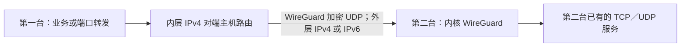

# 第二十二轮：WireGuard 实例间加密通道

本轮选择一种封装实现：Linux 内核 WireGuard。场景是让两台可信的受管实例，通过专用私网地址访问对端的 TCP／UDP 服务，或作为既有端口转发的后端通道。源码功能与隔离验收单独记录；本轮没有安装桌面更新、应用生产配置或创建发行版。

## 场景与范围

| 项目 | 本轮范围 |
| --- | --- |
| 平台 | 两台不同的受管 Debian 12／13 amd64；必须具备内核 WireGuard 和网络管理权限。 |
| 外层 | IPv4 或 IPv6，两台一致；归档地址必须实际绑定在对应服务器上，端口固定。 |
| 内层 | 两个不同的 RFC1918 IPv4 地址，各添加唯一对端 `/32` 主机路由。 |
| 管理对象 | 每台限一个受管 WireGuard 接口；两端统一审阅、部署、检查、移除和恢复。 |
| 运行方式 | 内核接口与一次性 systemd 服务；启用后不保留用户态隧道进程。 |
| 依赖 | 缺少时从服务器现有 APT 配置安装 `wireguard-tools`；不下载未知脚本，不切换生产软件源，不自动卸载共享工具包。 |
| 验收 | 两个方向各自的 TCP 与应用 UDP 随机挑战，另核对路由、身份、配置和管理连接。 |

本轮不提供默认路由 VPN、子网间路由、NAT、自动开启 IP forwarding、内层 IPv6、动态端点、NAT 地址改写、多对端或任意深度隧道图。不增加用户态 WireGuard 回退，也不同时引入其他封装引擎。它不是提速或抗封锁承诺：外层依赖 UDP，公网质量和提供商限制仍须实测。

第二十一轮的三实例透明转发保持独立。新隧道不会自动替换现有线路的端点、私钥、SNI、鉴权或客户端来源，也不把新的私网地址写回实例的公网／管理地址。

## 创建前准备

1. 两台均已完成部署或接入，SSH 和恢复凭据可用，没有其他待恢复任务。两份归档实际指向同一台机器时拒绝执行。
2. 确认两端所选外层地址实际存在且互通。此处的 IPv4／IPv6 是封装外层，不表示把原代理出口或内层地址一同改为该地址族。
3. 选择未使用的 UDP 端口。检查现有转发、独立入站、Hysteria2 跳跃范围、Shadowsocks 和实际内核监听，不能只看表单中是否重复。
4. 为内层选两个空闲的 RFC1918 IPv4 地址，避开 SSH 管理地址、外层地址、现有本地地址和主机路由。程序不会抢占已有主机路由；已有策略路由导致业务未走 `maywg0` 时也拒绝验收。
5. 对端必须可信。受管防火墙会允许该对端从隧道访问本机已有监听服务；不会替原服务重新设计应用层权限。不要把不信任的实例配为对端。
6. 服务器或提供商维护的外部防火墙须允许两端固定 UDP 端口。选择“保留既有防火墙”时，程序不修改它；需提前允许外层 UDP 及内层对端访问。

## 表单与参数

在实例详情选择 **WireGuard 实例间隧道 → 管理隧道**。任一参与实例都可查看同一记录；新建时当前实例为第一台，不能同时选择为第二台。

| 字段 | 规则和含义 |
| --- | --- |
| 隧道名称 | 1–60 个可打印字符，只用于显示。 |
| 第二台受管实例 | 与第一台不同；操作前还会比较实际机器身份。 |
| 外层地址族 | IPv4 或 IPv6，使用两端已归档的相应单播地址。 |
| 两端 UDP 端口 | 各为 1024–65535；分别属于不同主机，可以相同，也可以不同。 |
| 两端隧道内 IPv4 | 不同、规范、未占用的 RFC1918 地址。示例默认值只是表单初值，不能据此推断本机网络空闲。 |
| MTU | 1280–1420，默认 1380；保守留出封装余量，不进行自动带宽或路径 MTU 调优。路径更小时应按实际网络另行核对。 |
| 保活秒数 | 默认 0，关闭持续保活；需要时可设 15–120 秒。保活不能替代业务验收，也不是故障切换。 |

审阅列出两台实例、外层地址族、端口、内层地址、MTU、保活、依赖安装、防火墙影响和恢复范围。这里不输入、展示或导出私钥。取消审阅不会创建远端任务。

## 部署流程

1. **锁定并重新核对。** 按稳定顺序获取两台本地锁；审阅后任一归档、凭据文件、操作记录或相关远端程序变化，审阅均失效。
2. **双端预检。** 核对 Debian／架构、独立机器身份、SSH、现有资源、端口和地址占用；受管 nftables 还核对配置及实际规则。
3. **双端恢复点。** 仅保存 `WireGuardTunnel` 和确实涉及的受管防火墙；复用原有限时回滚保护和全局事务锁。其他代理、监控、Tunnel、DNS 和 SSH 配置不进入本次写入范围。
4. **生成密钥。** 两台分别调用官方 `wg genkey`，私钥写入本端 root 专用目录与 `0600` 文件，只交换公钥。恢复包可能包含本端私钥，因此包留在服务器，控制端只保存摘要和定位信息。
5. **建立通道。** 写入固定 systemd 单元与受管配置，创建内核 `maywg0`、明确的接口归属标记、内层地址与对端 `/32` 路由。原有接口、单元、链接路径或未受管同名目录均不能被接管。
6. **更新精确防火墙。** 受管模式只允许对端外层地址访问本端 UDP，以及 `maywg0` 上内层对端到本机的流量。既有 nftables 其他表保持原范围，不能用全局清空规则的方式应用。
7. **双向实际验收。** 依次启动短时、低权限的挑战接收器，从另一台绑定本端私网地址，经 WireGuard 发送 TCP 与 UDP 随机挑战并核对回应。发送前确认所选路由是 `maywg0`，发送后确认正确公钥的近期握手；没有直连回退。
8. **提交。** 停止短时接收器，再核对配置、启用状态、路由和管理连接，逐台提交并保存双端结果。跨主机提交不宣称瞬时原子完成。

一次检查的接收器有固定身份、来源限制、运行时长、内存和 CPU 上限；检查结束或失败均停止本次接收器。接收器不是监控常驻服务，也不是对任意来源开放的回显入口。

## 使用既有服务与转发

隧道只提供两台主机之间的通道。服务已监听本机所有地址或指定隧道内地址时，可以从对端访问；只绑定回环的服务不会自动变成可用后端。

需要端口转发时，仍在原 TCP／UDP 转发表单中建立规则，把目标地址填写为对端隧道内地址，目标端口填写为实际服务端口，并完成该转发自身的 TLS／SSH、代理或 UDP 应用验收。先验证后端服务，再验证转发后的入口，两者不能混为一次“接口已启动”。

受管转发规则依赖本隧道对端地址时，先移除相关规则，再移除隧道。程序不会为移除隧道擅自删除这些规则。其他手动配置或外部软件中的地址依赖仍需使用者自行核对；本轮不声称发现所有外部消费者。

## 健康、重启与维护

- **实例健康检查**读取该端的文件身份、启用状态、接口、公钥、Peer、AllowedIPs、端点和主机路由；不把旧的空闲握手当作新业务成功。
- **隧道页“检查双向 TCP／UDP”**重新执行两个方向的实际挑战。检查可能产生短时测试流量，但不改隧道、默认路由或长期配置。
- **重启恢复**由启用的 systemd 单元重新创建接口、地址和对端主机路由。若内核、端点或防火墙条件不满足，应保留失败状态并检查，不能悄悄切换实现或走明文路径。
- **修改参数或重新生成密钥**先解除使用者、移除旧隧道，再新建并验收；本轮不提供隐式原地轮换或强行覆盖外部修改。
- **移除**核对双方的实际归属和归档，仅删除本通道的接口、路由、单元、配置与密钥，恢复受管防火墙对应范围。共享 `wireguard-tools` 和历史恢复包不自动卸载／删除。

## 取消、确认丢失与恢复

| 情况 | 处理 |
| --- | --- |
| 任一台忙碌、地址／端口占用、实例别名或归档漂移 | 在写入前拒绝，释放已获取的锁。 |
| 密钥或应用响应丢失 | 不自动重发生成／应用命令；读取原任务与实际事务，按快照恢复。 |
| 一端已提交，另一端失败或提交确认丢失 | 核对原任务、公用隧道身份和冻结的恢复程序，对已提交端也执行本次范围补偿。 |
| 用户取消、TLS／SSH 之外的 TCP 成功但 UDP 回程失败 | 该次不能提交；停止挑战接收器并恢复两端。 |
| 外部改动文件、接口或其他任务接管 | 拒绝覆盖，保留待恢复记录，不把“命令已发出”当作完成。 |
| 补偿确认丢失或远端暂不可达 | 保留原任务和恢复点，从同一隧道继续核对；不从头重放创建。 |
| 仅连通性检查失败 | 记录最近检查失败，保留当前通道，供使用者继续诊断或明确移除。 |

待恢复实例页直接显示 **恢复两端隧道**，不会引导使用者用单机通用恢复拆开处理。活动／待恢复隧道会阻止实例退役、归档删除和不合适的恢复；本地双端记录缺失时也不能绕过保留的参与事务标记。

远端历史恢复点位于 root 专用备份范围，包含本端恢复所需的私密材料。控制端摘要不能替代服务器丢失后的私钥备份；本轮没有增加跨机器密钥导出功能。

## 验收记录与边界

- 实际两台临时 QEMU，分别为 Debian 12 与 Debian 13，43 项断言通过：外层 IPv4／IPv6、双向 TCP／UDP、保活关闭／25 秒、两台整机重启、完整移除、已提交端确认丢失补偿、移除中断后恢复原密钥及活动通道，以及 TCP 可用但内层 UDP 回应被独立规则阻断时的失败恢复。独立阻断表未被产品恢复误删。
- 重启按 `boot_id` 变化及服务恢复核对；最初仅等待服务活跃的夹具可能读到重启前状态，已纠正。默认路由比对只排除 RA 租约的自然倒计时，仍核对网关、设备、优先级和策略规则；DNS 与 IP forwarding 也保持原值。
- systemd `MainPID=0` 已核对，说明此实现不保留用户态通道进程；没有据此宣称内核内存为零或整个应用的资源占用已下降。
- C# 线路／入站／隧道组合回归的 897 项断言和基础边界回归的 272 项断言通过；专项覆盖模型、双端锁、审阅失效、随机证据、取消、丢失确认、恢复续做和归档依赖；合并原有转发／编排／入站回归。Linux Python 另有 15 项归属、路由、接口、密钥和恢复包边界测试。
- 原生界面只经已有后台测试接口验证表单、双端审阅、取消、任一端查看同一记录、待恢复入口和阶段展示；要求零激活、零前台焦点。
- 测试机的软件源下载使用临时夹具明确配置的现有无认证代理和 Debian 官方签名仓库；不修改 Windows／WSL 或生产 APT 设置。早期下载失败不计为成功部署，失败日志保留。

上述是隔离网络及生命周期验收，不是公网性能、提供商 UDP 可用性、真实业务吞吐或长时间稳定性证明。没有迁移生产节点、修改 Cloudflare、切换 Windows 代理／TUN 或安装更新。后续节点组复用仍按第二十三轮推进，不并入本轮。

复测入口：C# `--wireguard-only`、显式临时清单 `--wireguard-vm <manifest>`、后台 `suite.wireguard`、Linux `tests/test_wireguard.py`。自动回归同时纳入主校验和 CI；三机旧夹具仍可用于原编排测试，`--wireguard` 才切换为双机模式。

实现参考官方 [WireGuard 快速入门](https://www.wireguard.com/quickstart/)与 [wg 命令手册](https://git.zx2c4.com/wireguard-tools/about/src/man/wg.8)。这里采用明确的内核接口与主机路由，没有开放任意 wg-quick shell hook 或默认路由配置。
